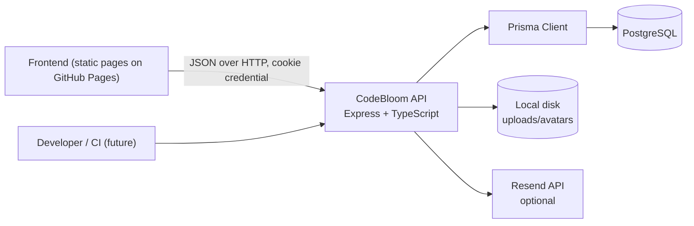
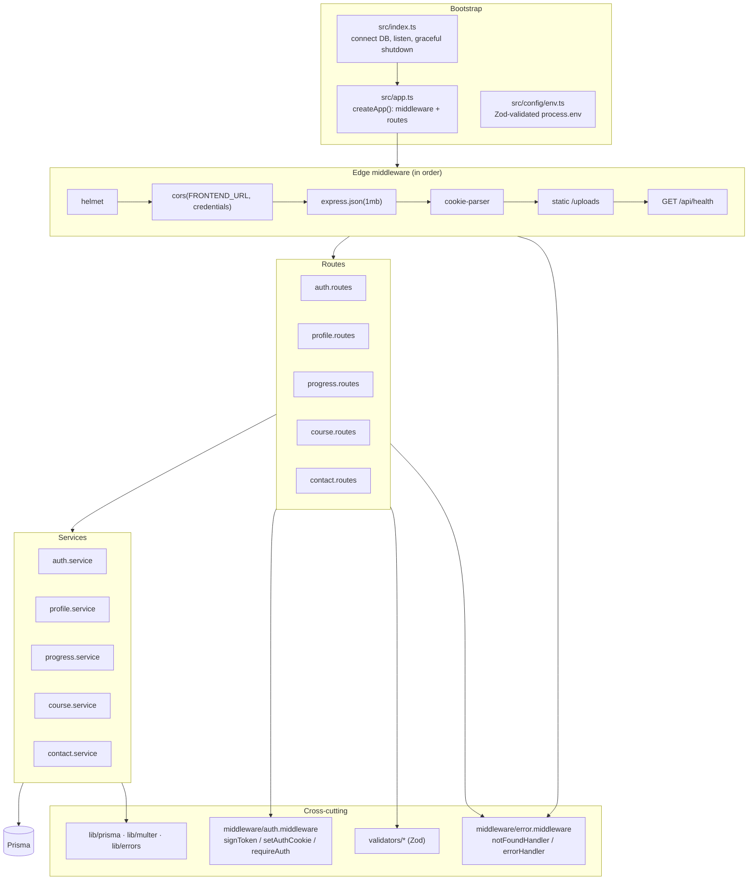
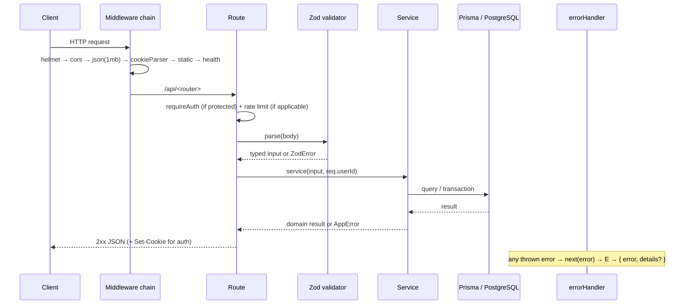

# CodeBloom — Backend High-Level Design

Status: `DRAFT` · Scope: backend only · Baseline: `main @ 2a98b93` · Fixes applied (uncommitted): G2, G3

## 1. Scope and current state

This document describes the backend as it exists today, not a target architecture. CodeBloom's backend is a single Express/TypeScript service backed by PostgreSQL through Prisma. It is fully implemented and unit/integration tested, but it is **not deployed**: there is no container, hosting manifest, or CI workflow for it. The only deployed surface is the static frontend on GitHub Pages (`.github/workflows/static.yml`).

In scope: API, domain model, authentication, persistence, file uploads, email, security controls, testing, runtime/deployment.

Out of scope: static lesson/challenge page content, client-side quiz and sandbox behavior, UI design.

## 2. Context



External systems:

| System | Purpose | Failure behavior |
|---|---|---|
| PostgreSQL | System of record for users, profiles, courses, lessons, challenges, progress, contact messages | Startup aborts (`prisma.$connect()` failure → `process.exit(1)`) |
| Resend | Sends contact-form notification email | Best effort; message is persisted first, send failure is logged, API still returns `201` |
| Local filesystem | Avatar image storage | Upload fails with a normalized `400`/`500` |

## 3. Technology choices

| Concern | Choice | Rationale / note |
|---|---|---|
| Runtime / language | Node.js + TypeScript | `tsx watch` in dev, `tsc` → `dist/` in prod |
| HTTP framework | Express 4 | Small, mature; layered route/service split |
| ORM | Prisma 6 + `@prisma/client` | Typed queries, schema-first model |
| Validation | Zod | Parsed at the route boundary; errors mapped centrally |
| Password hashing | bcrypt, 12 rounds | Sync-independent `hash`/`compare` |
| Session | JWT (HS256) in `httpOnly` cookie | `jsonwebtoken`, `cookie-parser` |
| Rate limiting | `express-rate-limit` | In-memory, per-process |
| Security headers | Helmet | With `crossOriginResourcePolicy: cross-origin` for uploaded avatars |
| File upload | Multer (disk storage) | 5 MB limit, MIME allowlist |
| Tests | Vitest + Supertest | Prisma mocked at `src/lib/prisma`; no live DB required |

## 4. Internal component view



### Module responsibilities

- `src/index.ts:5-28` — application entry point. Connects Prisma, binds `env.PORT`, and disconnects on `SIGINT`/`SIGTERM`.
- `src/app.ts:14-47` — assembles the middleware pipeline and mounts the five routers under `/api`, then 404 and error handlers last.
- `src/config/env.ts:6-24` — validates all configuration at import time and exits on invalid input. Required: `DATABASE_URL`, `JWT_SECRET` (≥16 chars), `FRONTEND_URL`, `CONTACT_EMAIL_TO`. Optional with defaults: `JWT_EXPIRES_IN=7d`, `PORT=4000`, `NODE_ENV=development`, `RESEND_API_KEY=""`, `TRUST_PROXY=0`. `TRUST_PROXY` should be `1` behind a single reverse proxy so `req.protocol` and rate-limit client IPs are correct.
- `src/routes/*` — thin controllers: validate, call one service function, send response, forward errors with `next(error)`.
- `src/services/*` — all business rules and Prisma access. No service throws raw Prisma errors; expected failures use `AppError`.
- `src/middleware/auth.middleware.ts` — token creation, cookie handling, and `requireAuth`.
- `src/middleware/error.middleware.ts` — single normalization point for all errors.
- `src/validators/*` — Zod schemas and inferred input types.
- `src/lib/*` — Prisma singleton, Multer configuration, `AppError`.
- `prisma/schema.prisma`, `prisma/seed.ts` — schema and deterministic seed: 5 courses, 72 lessons, 9 challenges.

## 5. Request lifecycle



`requireAuth` (`auth.middleware.ts:63-88`) reads the `token` cookie, verifies the JWT signature/expiry, reloads the user's `tokenVersion`, requires an exact match, then sets `req.userId`. Missing/invalid token → `401`.

## 6. Data model

```mermaid
erDiagram
    USER ||--o| PROFILE : has
    USER ||--o{ USER_PROGRESS : records
    COURSE ||--o{ LESSON : contains
    LESSON ||--o{ USER_PROGRESS : "itemType = lesson"
    CHALLENGE ||--o{ USER_PROGRESS : "itemType = challenge"

    USER {
        string id PK "cuid"
        string email UK "normalized lowercase"
        string passwordHash "bcrypt 12"
        int tokenVersion "default 0"
        datetime createdAt
        datetime updatedAt
    }
    PROFILE {
        string id PK
        string userId UK "FK → User, cascade"
        string displayName
        string bio
        string avatarUrl
    }
    COURSE {
        string id PK "seed slug: html, css, ..."
        string title
        string description
        string icon
        int totalLessons
        int order
    }
    LESSON {
        string id PK "seed slug"
        string courseId FK "cascade"
        string title
        string description
        string content
        int duration "minutes"
        int order
    }
    CHALLENGE {
        string id PK
        string title
        string level "beginner|intermediate|advanced"
    }
    USER_PROGRESS {
        string id PK
        string userId FK "cascade"
        enum itemType "lesson | challenge"
        string itemId
        datetime completedAt
        unique "userId + itemType + itemId"
    }
    CONTACT_MESSAGE {
        string id PK
        string name
        string email
        string subject
        string message
        datetime createdAt
    }
```

Design notes:

- `UserProfile` is 1:1 and created automatically on signup.
- `UserProgress` is a generic completion ledger keyed by `(userId, itemType, itemId)`; completion writes are idempotent `upsert`s.
- `Lesson.content` exists in the schema but seeded lessons leave it empty; actual lesson bodies currently live as static HTML in the frontend (see gap G4).
- `tokenVersion` is the revocation mechanism: changing a password increments it, invalidating every previously issued JWT.
- Indexes: `Lesson.courseId`, `UserProgress.userId`; unique constraints on `User.email`, `Profile.userId`, and the progress tuple.
- Schema history is committed at `backend/prisma/migrations/` (initial migration `20261118000000_init`). Local development uses `prisma migrate dev`; deployments must use `prisma migrate deploy`. `db:migrate:check` detects schema drift and requires `SHADOW_DATABASE_URL`.

## 7. API contract

All routes are prefixed with `/api`. Errors use `{ "error": string, "details"?: object }`.

| Method | Path | Auth | Rate limit | Success | Notes |
|---|---|---|---|---|---|
| GET | `/health` | – | – | `200 { status, timestamp }` | Liveness probe |
| POST | `/auth/signup` | – | 20 / 15 min | `201 { user }` + cookie | Duplicate email → `409`; creates profile in the same transaction |
| POST | `/auth/login` | – | 20 / 15 min | `200 { user }` + cookie | Wrong credentials → `401`; never leaks password hash |
| POST | `/auth/logout` | ✔ | – | `200 { message }` | Clears cookie |
| GET | `/auth/me` | ✔ | – | `200 { user }` | Frontend session check |
| PATCH | `/auth/password` | ✔ | 20 / 15 min | `200 { message }` | Verifies current password; bumps `tokenVersion` |
| GET | `/profile/me` | ✔ | – | `200 { profile }` | |
| PATCH | `/profile/me` | ✔ | – | `200 { profile }` | `displayName`, `bio`, `avatarUrl` (empty string clears it) |
| GET | `/profile/stats` | ✔ | – | `200 { stats }` | `memberSince` + progress stats |
| POST | `/profile/avatar` | ✔ | – | `200 { profile }` | Multipart `avatar`; deletes previous file; returns absolute URL built from request origin |
| GET | `/progress` | ✔ | – | `200 { progress }` | Newest completions first |
| GET | `/progress/summary` | ✔ | – | `200 { summary }` | `lessonsByCourse`, `completedChallenges`, `totalCompletedLessons` |
| POST | `/progress/lessons/:lessonId/complete` | ✔ | – | `201 { progress }` | `404` if lesson unknown; idempotent |
| POST | `/progress/challenges/:challengeId/complete` | ✔ | – | `201 { progress }` | `404` if challenge unknown; idempotent |
| GET | `/courses` | – | – | `200 { courses }` | Ordered by `order`; metadata only |
| GET | `/courses/:courseId` | – | – | `200 { course }` | Includes ordered lesson list |
| GET | `/courses/lessons/:lessonId` | – | – | `200 { lesson }` | Includes course, `prevLesson`, `nextLesson` |
| POST | `/contact` | – | 5 / hour | `201 { id, message }` | Honeypot `website`, HTML stripped, stored then emailed |

Route ordering detail: `/courses/lessons/:lessonId` is registered before `/courses/:courseId` so it is not shadowed by the parameterized course route (`course.routes.ts:8-26`).

## 8. Cross-cutting design

### Authentication and authorization

- Cookie: name `token`, `httpOnly`, `sameSite: lax` in development and `none` in production (required for cross-site frontend/API origins), `secure` when `NODE_ENV=production`, `maxAge` derived from `JWT_EXPIRES_IN` (`expiresInToMs` supports `s|m|h|d`, default 7 days).
- Payload: `{ userId, tokenVersion }`, signed with `JWT_SECRET`, expiry from `JWT_EXPIRES_IN`.
- Authorization is binary: either a valid session (`requireAuth`) or public. There are no roles/permissions in the model yet.
- `changePassword` is the only revocation path. Logout only clears the client cookie (stateless).

### Validation and errors

- All external input is validated with Zod at the route boundary (`signup`, `login`, `changePassword`, `updateProfile`, `contact`).
- `AppError(statusCode, message, details?)` is the domain error type; `isAppError` is the type guard.
- Central mapping: `ZodError → 400` with flattened field errors; `MulterError LIMIT_FILE_SIZE → 400`; other `MulterError → 400`; `AppError → its status`; unknown → `500` with the original logged server-side.
- Unmatched routes → `404 { error: "Route not found" }`.

### Rate limiting

- Auth limiter: 20 requests per 15 min on signup, login, and password change.
- Contact limiter: 5 requests per hour.
- Limits are in-memory per process; a multi-instance deployment would need a shared store (see G5).

### File storage

- Multer disk storage writes to `<cwd>/uploads/avatars` with filename `<userId>-<timestamp><ext>`.
- Allowed MIME types: JPEG, PNG, WebP, GIF; maximum 5 MB.
- `uploadAvatar` deletes the previous file before saving the new URL. Static serving is mounted at `/uploads`.

### Email

- `contact.service` always inserts `ContactMessage`, then attempts Resend delivery if `RESEND_API_KEY` is present. Failures are logged and swallowed so the user still gets a success response.
- Sender is fixed to `onboarding@resend.dev`; recipient is `CONTACT_EMAIL_TO`.
- Honeypot field `website` must be empty; all free-text fields are stripped of HTML tags before persistence.

## 9. Security posture

Implemented: helmet headers, single-origin CORS with credentials, strict JSON body limit, bcrypt hashing, httpOnly/secure/sameSite cookie, JWT signature + expiry + `tokenVersion` check, rate limits, Zod input validation, multipart MIME/size filtering, HTML stripping and honeypot on the contact form, no password hash in any response.

Not yet implemented: CSRF token (production now uses `SameSite=None`, so this mitigation is gone), role-based authorization, account lockout beyond rate limiting, email verification, password reset, shared/distributed rate-limit store, file scanning, audit logging.

## 10. Testing strategy

- `npm test` → `vitest run`; configuration in `test-preferences.json` (npm, Vitest, Supertest, tests under `backend/tests`, `*.test.ts`).
- `tests/setup.ts` provides safe test env defaults (separate `codebloom_test` database name).
- Coverage is organized by layer: `tests/routes/*`, `tests/services/*`, `tests/middleware/*`, `tests/validators/*` (15 files).
- Route tests mock `src/lib/prisma` with Vitest spies and drive `createApp()` through Supertest — no live database needed.
- No E2E tool is configured; frontend-to-backend integration (including cookie/CORS behavior) is not automatically verified.
- `npm run db:migrate:check` verifies `schema.prisma` matches the committed migrations (needs `SHADOW_DATABASE_URL`).

## 11. Deployment view

**Today**

```
Developer machine:  PostgreSQL ← Prisma ← Express (:4000) ← frontend (:5500)
GitHub Actions:     push main → generate config.js from API_BASE_URL secret → upload ./frontend → GitHub Pages
```

**Hard constraints in the current code**

- `FRONTEND_URL` allows exactly one CORS origin.
- The frontend reads `window.CODEBLOOM_CONFIG.API_BASE` from the checked-in `frontend/config.js` (localhost default), regenerated in CI from the `API_BASE_URL` secret. Production cookies use `SameSite=None; Secure` because the two origins are cross-site.
- Avatars are written to the backend process's local filesystem.
- Rate limits and the session model assume a single process.

**Recommended target (not yet implemented)**

```
Browser → CDN/static host (frontend, env-driven API URL)
        → HTTPS → API service (container) → managed PostgreSQL
                                         → managed object storage (avatars)
                                         → Resend
CI: test → build → migrate → deploy API → deploy frontend
```

## 12. Known backend gaps / prioritized backlog

| ID | Gap | Impact | Suggested fix |
|---|---|---|---|
| G1 | Backend has no deployment pipeline or hosting config | Authenticated features unreachable from the deployed site | Add Dockerfile + API deploy workflow; supply production env/secrets |
| ~~G2~~ | ~~Frontend hardcodes localhost API URL~~ | — | **Resolved:** `config.js` + CI generation from `API_BASE_URL` secret |
| ~~G3~~ | ~~No committed Prisma migrations~~ | — | **Resolved:** initial migration committed; `db:migrate:deploy` / `db:migrate:check` added |
| G9 | CSRF protection now needed with `SameSite=None` in production | Cross-site state-changing requests are not blocked by cookie policy | Add CSRF token or double-submit cookie; keep `Secure` and strict CORS |
| G4 | `Lesson.content` empty; authoritative content lives in static HTML files | API cannot serve real lesson bodies; progress IDs decoupled from content | Migrate lesson content into DB or introduce a content service with stable IDs |
| G5 | In-memory rate limits + local disk uploads | Breaks with multiple instances or restarts | Shared store (Redis) for limits; object storage for avatars |
| G6 | No refresh-token or email-verification/password-reset flow | Session UX and account recovery limited | Add refresh tokens and time-limited reset tokens with `tokenVersion` integration |
| G7 | No audit logging or request correlation IDs | Hard to diagnose production issues | Structured logging middleware + request IDs |
| G8 | No role-based authorization | All authenticated users have equal access | Add `role` to `User` and an authorization middleware |

## 13. Open questions

1. Target host for the API (PaaS, VM, or container platform) and whether PostgreSQL will be managed or self-hosted.
2. Whether lesson/challenge content should be moved into the database or remain static files with a metadata API.
3. Whether avatars should move to object storage before or after the first production deployment.
4. Who owns production secrets and how `FRONTEND_URL` is set for multiple environments (local, staging, production).
